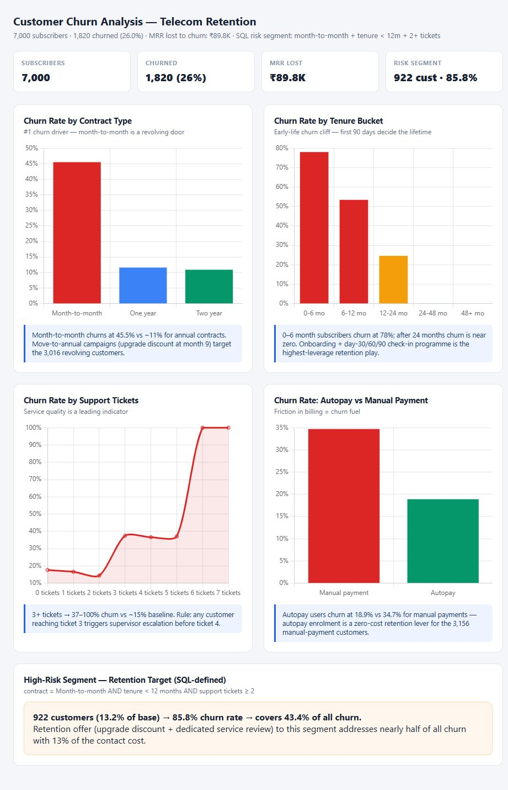

# 📉 Customer Churn Analysis (SQL · Telecom · Dashboard)

**Business question:** *Which subscribers are most likely to churn next month, and what retention actions stop the bleeding?*

## ▸ Project Highlights

▸ Analysed **7,000 telecom subscribers (1,820 churned, 26.0% churn rate)** across contract type, tenure, support tickets, charges, service type and payment behaviour.

▸ Found **contract type is the #1 churn driver**: month-to-month customers churn at **45.5%** vs 11.6% (one-year) and 10.9% (two-year) — locking customers into annual plans is worth ~34 points of churn.

▸ Uncovered the **early-life churn cliff**: subscribers with <6 months tenure churn at **78%**, falling to 53% (6–12m), 25% (12–24m) and near-zero after 24 months — the first 90 days decide the customer lifetime.

▸ Identified **support tickets as a leading indicator**: 3+ tickets → churn jumps to **37–100%** vs ~15% baseline; a high-ticket customer is already halfway out the door.

▸ Built a **high-risk segment in pure SQL** (month-to-month + tenure < 12m + 2+ tickets): only 922 customers (**13% of base**) but **85.8% churn rate** — a retention offer targeted here addresses 43% of all churn with 13% of the spend.

▸ Quantified the business impact: churned subscribers carry **₹89.8K MRR**; autopay users churn at 18.9% vs 34.7% for non-autopay — autopay enrolment is a zero-cost retention lever.

## 📂 Structure

- `data/` — 7,000-row subscriber dataset (CSV + SQLite `data.db`)
- `sql/queries.sql` — 7 analyses: contract, tenure, tickets, charges, service, autopay, risk segment + MRR at risk
- `dashboard/` — interactive HTML dashboard (`index.html` + `agg_data.json`) + `screenshot.jpg`

## ▸ Key Insight

> Churn is not random — it is concentrated in **month-to-month contracts, the first year of tenure, and customers with 3+ support tickets**. A 922-customer high-risk segment (13% of base) covers 43% of all churn: retention budget should follow this rule, not blanket discounts.

## ▸ Tools

SQL (SQLite) · Cohort/rate analysis · Risk segmentation · Revenue-at-risk modelling · Interactive dashboard (Chart.js)
